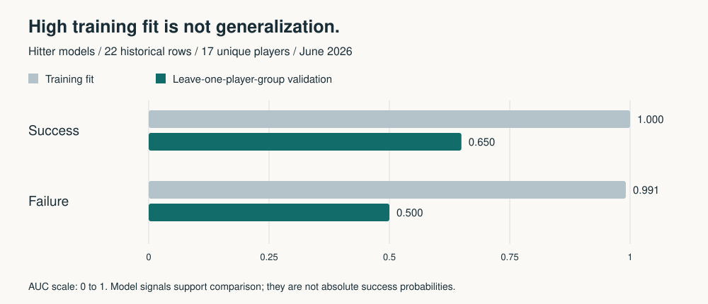

# 공개 결과 확인

기준: 2026년 6월 최종 산출물. 최신 후보 추천이나 모델 재학습 결과가 아닙니다.

## 최종 접촉 우선순위

| 구분 | 순위 | 후보 |
|---|---:|---|
| 타자 | 1 | Will Brennan |
| 타자 | 2 | Dominic Fletcher |
| 타자 | 3 | Dylan Carlson |
| 투수 | 1 | Josh Fleming |
| 투수 | 2 | Keegan Thompson |
| 투수 | 3 | Kolby Allard |

## 학습 적합과 선수 단위 검증

| 대상 | 학습 행 수 | 고유 선수 | 학습 AUC | 선수 단위 제외 AUC |
|---|---:|---:|---:|---:|
| success | 22 | 17 | 1.000 | 0.650 |
| failure | 22 | 17 | 0.991 | 0.500 |

학습 데이터 적합도는 일반화 성능이 아닙니다. 모델 출력은 절대 성공확률이 아닌 후보 비교의 보조 신호로 해석합니다.

## 원표와 방법

- [최종 후보 원표](../../outputs/tables/final_candidate_board_execution_v4.csv)
- [검증 원표](../../outputs/tables/model_probability_calibration_audit_v1.csv)
- [최종 검증 해석](../final_report_last_validation_v1.md)
- [예제 실행 방법](README.md)

이 문서와 그림은 `python3 scripts/portfolio_demo.py --write`로 공개 CSV에서 생성합니다.
